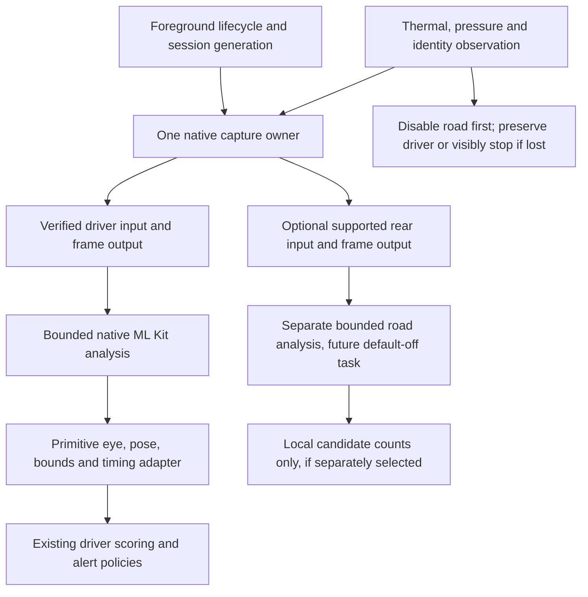

# Road-camera architecture decision

**Status:** Proposed implementation direction; documentation only.

**Reviewed:** November 1, 2026 against `main` at
`72f5f0e809b263aa7f6aa3d5ada3b1cde0d83f50`.

**Scope:** [Task 3.1](VISION_ROADMAP.md#task-31--dual-capture-architecture-decision).
Implementation, candidate builds and promotion require separate selection and
the evidence below. [Product contracts](APP_ROADMAP.md) take precedence.

## Decision

Recommend **one library-backed VisionCamera v5 MultiCam session** for a future
isolated compatibility prototype. Investigate the reviewed stable **5.2.4**
camera and **2.1.0** face-detector APIs first; these are research candidates,
not approved dependency replacements. Prefer a custom native driver output
adapter into the existing scalar eye-analysis contract, preserving the
baseline-declared ML Kit version and current options subject to resolved-Pod
verification. Keep the current v4 driver-only binary as the comparison baseline
until parity is demonstrated.

Choose a bespoke AVFoundation/ML Kit capture owner only if the prototype cannot
provide exact camera identity, pressure observability, bounded frame ownership
or driver-preserving road shutdown. Record the failing contract before changing
direction. This recommendation is engineering judgment: upstream now supplies
the capture graph, so duplicating it should need demonstrated justification.
It is not a finding that v5 works with Occulert's current native toolchain.

This document enables no road capture, model, storage, alert or permission.
Tasks 3.2–3.4 retain their separate selection, authorized-input and default-off
gates. Road observations must never suppress or strengthen driver alerts.

## Current source and its limits

The [native manifest](../native-app/package.json) and
[lockfile](../native-app/package-lock.json) define this baseline:

| Component | Current resolved version |
|---|---|
| Expo / React Native / React | 58.0.22 / 0.88.1 / 19.3.0 |
| VisionCamera / face detector | 4.7.3 / 1.10.2 |
| Nitro Modules | 0.36.5 |
| Worklets Core | 1.6.3, directly used by the driver |
| React Native Worklets | 0.13.0, already present transitively; a distinct package |

The [October 4 camera plan](VISION_CAMERA_UPGRADE_PLAN.md) remains historical:
its Expo 57 / RN 0.86 baseline and detector 2.0 investigation are not today's
compatibility set. There is no checked-in iOS `Podfile.lock` here; JavaScript
resolution does not establish the exact native Pods in a candidate binary.

| Existing component | Reuse and preservation boundary |
|---|---|
| [Monitor analysis](../native-app/hooks/useMonitorAnalysis.ts) | Single v4 driver stream; native ML Kit eye-open probabilities, fast classification, largest face, missing eyes `-1`, explicit no-face result. Only primitive eyes, pose, bounds, frame dimensions and inference duration cross to JS. Preserve scoring, thresholds and alert timing. |
| [Capture wrapper](../native-app/components/MonitorCaptureCamera.tsx), [load model](../native-app/lib/captureLoadPolicy.ts) | Default-off experiment adds no format/fps props when disabled. Its optional 30/15 capture fps is separate from the existing 100/200 ms pre-inference throttle in [camera resilience](../native-app/lib/cameraResilience.ts). Neither is a road-stream default. |
| [Camera lifecycle](../native-app/hooks/useMonitorCameraLifecycle.ts) | Ten-second startup grace, five-second stall deadline, one shared automatic restart budget, bounded interruption query and owner/epoch guards. A road reconfiguration cannot repeatedly renew grace or fabricate a healthy driver sample. |
| [Device-condition module](../native-app/modules/occulert-device-condition/ios/OcculertDeviceConditionModule.swift) | Its parked `buildMultiCamGraph` creates two outputs with explicit connections. The 3–10-second stability test only counts frames and drops the rear connection under load. It performs no driver inference, preview integration or road analysis. |

The parked graph selects a generic supported front/back pair using default
formats. It does not bind the monitor's actual driver device/active physical
constituent or include the separate Duo discovery rules. A passing probe is
neither proof of the intended driver-plus-road topology nor sustained thermal
or ML Kit evidence. Reuse its configuration/fallback patterns, not its result
as acceptance. Never run that diagnostic graph beside the monitoring owner.

## Options considered

| Dimension | A: bespoke native dual-capture module | B: refreshed VisionCamera session (recommended first) |
|---|---|---|
| Graph owner | New Expo module owns one `AVCaptureMultiCamSession`, front/rear inputs, outputs and preview. | One imperative `CameraSession` owns both input connections and preview/frame outputs. Two independent `<Camera>` owners are insufficient. |
| Driver processing | Native ML Kit `VisionImage` from the front sample buffer; implement the scalar adapter. Existing device-condition module has no ML Kit dependency today. | Custom native output invokes ML Kit and emits primitives; an explicit frame output plus native Nitro detector is another adapter option. Adapt v4 hooks and JS delivery deliberately. |
| Control | Direct format, pressure, device and connection access; all capture/recovery code becomes ours. | Existing capture/lifecycle implementation; same-session native observability or an upstream extension is still needed for pressure and physical identity gaps. |
| Main cost | Own buffer lifetime, orientation, preview, interruptions and platform maintenance; avoid duplicating fatigue logic in Swift. | Coordinated camera/native-output/Nitro review and current v4 install-patch review; detector/worklets migration only if that adapter is selected. Broad peer ranges are not validation. |
| Fallback | Direct rear-port/connection disable, subject to measured driver continuity. | Must prove road-only disable/reconfiguration does not stall or restart the driver. Public session APIs alone do not establish that property. |

Apple documents simultaneous capture through
[AVCaptureMultiCamSession](https://developer.apple.com/videos/play/wwdc2019/249/).
Option A would use explicit input-to-output connections and separate front/road
processing queues. Google's [iOS ML Kit guide](https://developers.google.com/ml-kit/vision/face-detection/ios)
supports sample-buffer input and synchronous detection. It does not establish
parity with the current plugin's orientation, bounds or missing-eye handling;
those need comparison tests. Do not fabricate a v4 `Frame` to reuse its plugin.

For B, the official [Multi-Camera API](https://visioncamera.margelo.com/docs/multi-camera)
provides `supportsMultiCamSessions`, `createCameraSession(true)` and
`supportedMultiCamDeviceCombinations`, with distinct outputs per input. Pass
the supported logical devices to configuration; a virtual device's constituent
list is not a replacement list of independently configurable inputs.
[Session lifecycle](https://visioncamera.margelo.com/docs/camera-session)
provides interruption listeners and explicit stop/disposal. Therefore the
library option is viable to investigate; the historical v4 limitation cannot
be used to dismiss it.

The reviewed v5 public session/device interfaces do not expose the required
AVFoundation hardware/pressure costs and per-device pressure state. A native
observer/extension must inspect **the same owned session**, including its
active driver constituent. Creating a second probe session to estimate the
running owner's state is not an acceptable substitute. Prove access and
road-disable semantics before committing to this integration path.

The tagged [session interface](https://github.com/margelo/react-native-vision-camera/blob/v5.2.4/packages/react-native-vision-camera/src/specs/session/CameraSession.nitro.ts)
and [native implementation](https://github.com/margelo/react-native-vision-camera/blob/v5.2.4/packages/react-native-vision-camera/ios/Hybrid%20Objects/HybridCameraSession.swift)
support multiple connections and removing unwanted graph elements. Configuring
only the driver connection is a plausible downgrade, but also reconfigures the
remaining driver. Continuity during that operation is an open experiment.

## Compatibility review required before implementation

The [5.2.4 release](https://github.com/margelo/react-native-vision-camera/releases/tag/v5.2.4)
is the stable camera candidate reviewed on this date. The investigated
[detector 2.1.0](https://github.com/luicfrr/react-native-vision-camera-face-detector/releases/tag/v2.1.0)
is newer than the October plan. Their tagged manifests, types and native code
must be frozen together with the published package integrity before a prototype.
Upstream example dependency sets differ from Expo 58 / RN 0.88.1 / React 19.3;
permissive peer declarations do not certify that combination. See the tagged
[camera manifest](https://github.com/margelo/react-native-vision-camera/blob/v5.2.4/packages/react-native-vision-camera/package.json)
and [detector manifest](https://github.com/luicfrr/react-native-vision-camera-face-detector/blob/v2.1.0/package.json).

V5 JavaScript/worklet frame callbacks require
`react-native-vision-camera-worklets` and `react-native-worklets`, rather than
the current Worklets Core adapter. The preferred custom native output need not
use that callback runtime. Existing transitive Worklets 0.13.0 does not prove
Babel/runtime compatibility or replace
an explicit dependency decision. The [Worklets compatibility table](https://docs.swmansion.com/react-native-worklets/docs/guides/compatibility/)
lists 0.13.x for RN 0.88; this is one dependency's support, not whole-stack proof.
Review Nitro/Nitro Image requirements, native autolinking, minimum OS versions,
ML Kit Pods, simulator architecture exclusions
and Android packaging. Keep Expo's supported dependency set; no peer overrides
or unrelated SDK jump to make installation pass.

Detector 2.1's [podspec](https://github.com/luicfrr/react-native-vision-camera-face-detector/blob/v2.1.0/VisionCameraFaceDetector.podspec)
requests ML Kit FaceDetection 9.0.0, while the installed 1.10.2 plugin declares
8.0.0. Selecting 2.1 therefore includes a native detector dependency change;
do not silently accept that or its different defaults. It is not required for
library-owned capture: the supported
[custom native output API](https://visioncamera.margelo.com/docs/custom-native-camera-outputs)
can host a reviewed baseline-ML-Kit adapter in the same session. Verify its
actual resolved dependency and image-coordinate mapping before claiming parity.

Audit [SDK 58 compatibility patches](../native-app/scripts/patch-sdk58-camera.mjs)
and the separate, default-off
[multitasking patch](../native-app/scripts/patch-camera-multitasking.mjs).
The latter explicitly requires v4.7.3; neither patch can be silently carried
into v5 or removed without replacing its tested contract. A JS flag cannot
swap installed camera majors. Compare separate baseline/candidate binaries and
restore the complete native dependency/adapter/binary set for rollback.

## Proposed ownership and data flow

The owner serializes configure/start/stop and gives every output/result a
session generation and camera identity. The driver has its own bounded worker;
road work has a separate bounded worker and no queue of old frames. Driver
samples never wait for paired road samples. This is not a synchronized stereo
or calibrated-distance pipeline; such a model would need additional evidence.

With B's preferred native output, apply throttling **before** ML Kit at the
existing 100/200 ms intervals and emit capture age and inference duration with
the scalar result. If using the alternative frame-output/Nitro path, retain the
detector object and call its bound method. Detector 2.1's convenience output
has face dimensions, but its faces-only callback is not by itself an adapter for
capture timestamps, inference duration and Occulert's pre-inference throttle.
Keep face-size selection, unavailable eyes, actual image dimensions, orientation
and mirroring semantics explicit; portrait UI does not establish buffer pose.
[Orientation metadata](https://visioncamera.margelo.com/docs/orientation)
must be interpreted before setup bounds and head angles are consumed.

Each [v5 frame](https://visioncamera.margelo.com/docs/frame-output) has one owner
and exactly one disposal after its final use, including throttled, busy,
exception, no-face, stopped and stale-generation paths. For an
[async runner](https://visioncamera.margelo.com/docs/async-frame-processing),
release rejected/busy frames immediately; accepted work releases in `finally`.
For native outputs in either option, obey sample-buffer/pixel-buffer retention
and release rules on bounded native queues; [discard late frames](https://developer.apple.com/library/archive/technotes/tn2445/_index.html)
instead of growing a backlog. Neither path sends frames or native objects to
React state, History, cloud APIs or fleet reports.

Before delivery, reject stale identity/generation and measure capture-to-result
age separately from inference time. A JS callback's arrival time cannot make an
old capture fresh. Stop, unmount, background, safe-stop navigation, account or
consent boundary changes invalidate pending work; a late result cannot update a
new drive, refresh watchdog health, restart alerts or write observations.

## Driver-first resource and interruption policy

Admission requires runtime MultiCam support, an exact supported device pair,
both formats marked
[MultiCam-compatible](https://developer.apple.com/documentation/avfoundation/avcapturedevice/format/ismulticamsupported),
and a measured configuration that preserves usable driver input. Reject road
when [hardware cost](https://developer.apple.com/documentation/avfoundation/avcapturemulticamsession/hardwarecost)
exceeds 1, or the configuration cannot run sustainably. Monitor
[system pressure cost/state](https://developer.apple.com/documentation/avfoundation/avcapturemulticamsession/systempressurecost)
and actual ML/CPU/GPU load: capture-cost estimates alone do not budget inference.
Runtime capability checks replace phone-name allowlists.

The future road policy removes road processing **and streaming** first at serious
thermal state, high system pressure, unavailable budget, unsupported pairing or
road failure. Dropping only inference frames does not turn off the rear sensor.
Five road analyses per second is a Task 3.2 evaluation candidate, not an approved
capture rate or sustained-load promise. Preserve current driver load reduction
and critical-heat stop. If driver format, freshness or tracking cannot remain
usable, visibly stop under existing policy; never claim driver-only fallback
because only a rear output was disabled.

Keep road disabled for the remainder of the drive after fallback in the first
prototype; reconsider only at a new parked start. This proposed conservative
rule avoids road restart oscillation and needs tests before implementation.
Do not hide reconfiguration gaps by resetting driver clocks, grace or recovery
budgets. Prefer a driver-only graph within the same owner; any owner handoff
must stop/release the old graph before another starts and expose an actual gap.

Map native [interruption reasons](https://developer.apple.com/documentation/avfoundation/avcapturesession/interruptionreason)
to the existing [interruption model](../native-app/lib/cameraInterruptions.ts),
with session/device/sequence guards. Preserve the current multitasking latch,
bounded query and one-restart budget. Foreground loss stops both streams;
returning active or receiving interruption-ended does not resume monitoring.
Permission loss, a call, system shutdown and a driver stall remain explicit
unavailable/stopped outcomes. Road-only failure can retain driver monitoring
only while actual driver samples continue. No multitasking capability check
authorizes background monitoring or a new automatic-resume behavior.

## Duo identity and folded-only road eligibility

Preserve [front identity normalization](../native-app/lib/frontCameraIdentity.ts),
[switch policy](../native-app/lib/frontCameraSwitch.ts) and
[native constituent observation](../native-app/modules/occulert-device-condition/ios/OcculertFrontCameraIdentity.swift).
Bind the selected logical device and the active physical streaming constituent;
a stable virtual front ID does not establish a stable physical camera. Keep
SDK/runtime availability guards and owner/revision/sequence rejection.

The [Duo policy](DEVICE_ROADMAP_2026_2028.md#iphone-duo-driving-mode-policy-and-acceptance)
permits road operation only while folded. Outer/inner camera identity is not
independently measured hinge posture. A reliable folded-state evidence source
and its freshness/loss behavior remain **unresolved prerequisites**; no new
hinge API is assumed here. Until demonstrated, Duo road eligibility stays
unavailable even if a generic front/back probe passes. Unknown identity,
unfolding or unproven posture disables road availability.

Preserve driver behavior on a confirmed physical switch: clear the optional eye
baseline, reset parked setup as appropriate and issue one notice; retain
monitoring while driver frames continue. Temporary unknown is not a confirmed
switch. Fold changes must not introduce a new driver-stop rule; real driver
loss still follows existing recovery/stop policy. Physical Duo, night, mount,
camera-switch and sustained-load acceptance remain open. Simulator layout
fixtures establish none of these camera properties.

## Evidence still missing and next decision gates

| Gate | Required evidence before advancing |
|---|---|
| Exact compatibility prototype | Separately selected implementation; frozen camera/native-output/Nitro/Babel/Expo set and any selected detector, Nitro Image or worklets dependencies, package integrity and actual native dependencies. Clean Node 24 root/native verification with npm 11 and EAS npm 10.9.8; dependency checks and unchanged Watch/Android contracts. |
| One-owner capture and pressure adapter | Same-session pressure/identity access, exact supported pair/formats, teardown ownership, road-only sensor shutdown and measured driver continuity. Exercise permission denial, configuration failure, rapid stop/start, interruption and stale completions. |
| Driver parity | Authorized labeled comparison against the current driver-only binary: usable coverage, missing eyes, largest-face selection, orientation/bounds/pose signs, capture age, inference latency, event timelines and false/missed alerts. Keep thresholds fixed. Extend real adapter/lifecycle tests, not a disconnected model. |
| Buffer/resource safety | Throttle/busy/drop/exception paths dispose exactly once; bounded work and memory through repeated start/stop and pressure fallback. Measure CPU/GPU, frame drops, battery and heat for 30/60 minutes with the intended mount, charging and audio/Watch routes under [device acceptance](DEVICE_ACCEPTANCE.md). |
| Duo | Physical exact-build folded-state evidence, active constituent changes, same-pair capability and low-light/thermal tests. No supported-device claim from a simulator or short generic probe. |
| Road model and privacy | Task 3.3 authorized/licensed labeled clips and model provenance, latency/size/lighting evaluation before Task 3.4. Explicit local-only candidate-count schema and resets; no frames, raw timelines, locations, cloud fields or fleet exposure. Review camera-purpose wording before sustained rear capture; today's permission describes only a brief parked test. |
| Promotion or fallback decision | Owner reviews exact-source/native-build/device/benchmark evidence separately from CI. If a library gate fails, document it and select the native-owner alternative for a new prototype. Neither route promotes road signals into alert decisions without separate validation and authorization. |

This review inspects source and official API contracts. It compiles no camera
candidate, validates no physical capture configuration and selects no road
model. The next useful result is a separately selected compatibility prototype
with a falsifiable driver-parity and road-fallback report, not a support claim.
